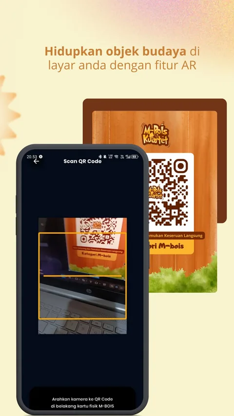
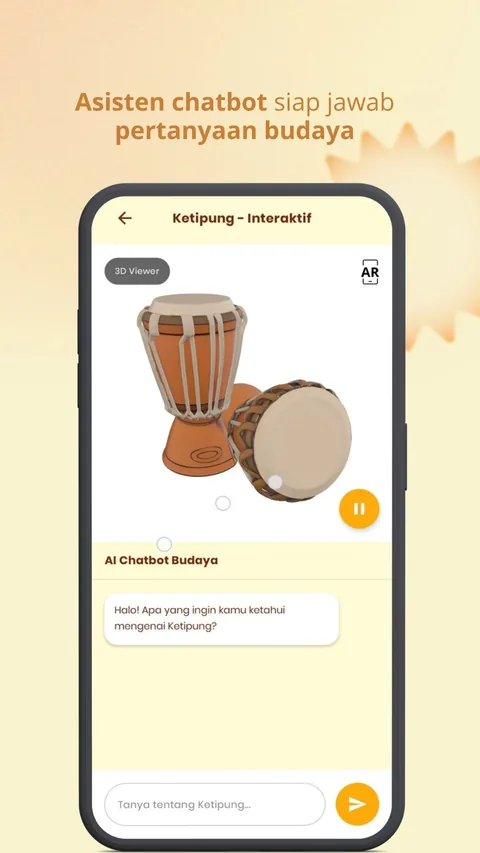
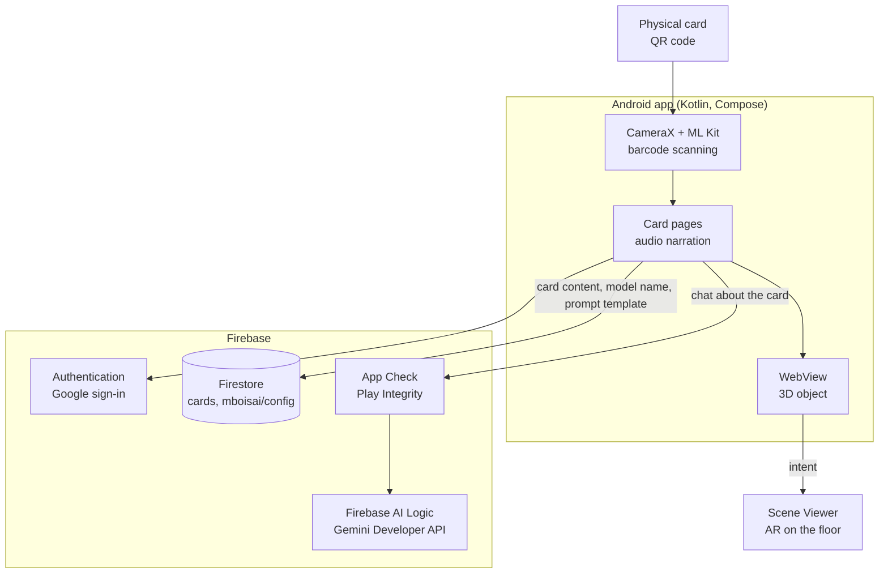

# M-BOIS

[](https://github.com/khrlanamm/M-BOIS/actions/workflows/ci.yml)


Companion Android app for M-BOIS Kuartet, a card game about the history, arts, and food of East Java. Scanning a physical card opens its 3D object in AR, an audio narration, and a Gemini assistant that answers questions about that card. Top 50 of the student category at BudayaGO! 2025.

[Google Play](https://play.google.com/store/apps/details?id=com.kuartet.mbois) | [Website](https://m-bois.web.app)

## Screenshots

| Card scan | Gemini chat | AR object |
|---|---|---|
|  |  |  |

## Architecture



## Features

- **Card catalog**: every card grouped by category, with its image, short and full description, and audio narration.
- **Card scan**: point the camera at the QR code on a physical card to open its page (CameraX and ML Kit).
- **Interactive mode**: the card's 3D object in AR next to a Gemini chat about the card.
- Google sign-in, onboarding for new users, and a profile screen with the app version and logout.

## Data

Firestore holds the content, so cards and AI settings change without a new build:

- `cards`: name, category, descriptions, and the URLs of the card image, icon, audio, and AR object.
- `mboisai/config`: the Gemini model name and the system instruction template. The template fills in `{card_name}` and `{category_name}` for the card being discussed.
- `activity/{email}`: the last time each user opened the app.

Gemini is called through Firebase AI Logic (Gemini Developer API), so the app ships no Gemini API key. Firebase App Check guards those calls, with Play Integrity in release builds and the debug provider in debug builds.

## Stack

Kotlin, Jetpack Compose, Material 3, Navigation Compose, CameraX, ML Kit Barcode Scanning, Firebase Authentication, Firestore, and App Check, Credential Manager, Firebase AI Logic (Gemini), Coil, Compose Markdown.

Minimum SDK 24 (Android 7.0), target SDK 36.

## Build

1. Create a Firebase project with Authentication (Google), Firestore, and Firebase AI Logic (Gemini Developer API), then put its `google-services.json` in `app/`. The file is not committed.
2. For debug builds, register the App Check debug token printed in Logcat in the Firebase Console (App Check, Apps, Manage debug tokens).
3. Build:

   ```sh
   ./gradlew :app:assembleDebug
   ```

## Tests

```sh
./gradlew testDebugUnitTest
```

Unit tests cover card grouping and ordering, the Gemini prompt template and model fallback, playback time formatting, and navigation routes. CI runs them on every push.

## Team

Developed by Tim M-BOIS. Lead developer: Khoirul Anam (khoirulanam1604@mail.ugm.ac.id).

## License

Copyright © 2025 Tim M-BOIS. All rights reserved. The source code is public for reference only. See [LICENSE](LICENSE). The Poppins font in `app/src/main/res/font/` is licensed separately under the SIL Open Font License.

---

**M-BOIS**: Main Budaya, Ojo Ilang Saklawase!
